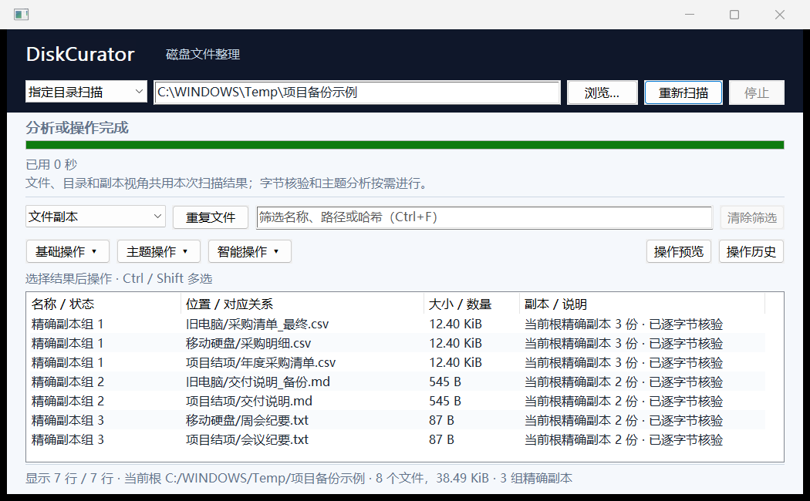

# DiskCurator · Windows 磁盘文件整理工具

准备换电脑时，旧硬盘上往往还躺着好几份“桌面备份”。改过名字的照片可能是同一张，两个都叫“最终版”的报价单却可能写着不同的价格。DiskCurator 帮你按文件内容找副本、对照两份备份的差异，再决定哪些该留下、哪些该归到一起。

适用于 **Windows 10 / 11 x64**，解压即可运行。扫描和核对都在本机完成，整理前可以逐项查看文件会从哪里移到哪里。

**[下载 Windows 便携版 v1.0.4](https://github.com/drizzletown/DiskCurator/releases/download/v1.0.4/DiskCurator-Native-v1.0.4-Win64.zip)** · [所有版本与校验文件](https://github.com/drizzletown/DiskCurator/releases)

## 什么时候用得上？

- **换电脑，核对旧硬盘里的备份。** 同时扫描选定的磁盘，点“重复文件”就能看到同一内容可能存在哪些位置，即使文件已经改名。需要确认时，可对选定范围内的候选副本逐字节核验。
- **项目交接，合并两份“最终版”。** 工作目录里同时有 `项目交付` 和 `项目交付_修订`？用“评估两个目录”查看各自独有的文件，以及同一路径下内容不同的版本。确认融合预览后，工具会把缺少的文件复制到目标目录。同名冲突另存为不同版本，两个目录里的原文件都能保留。
- **整理几年的手机照片。** 将导出的照片按拍摄年月归档，缺少拍摄日期时，可选择按文件修改日期归档。遇到连拍或相似画面，可以列出候选照片，再由你挑选喜欢的那张。
- **收拾堆满附件的下载目录。** 把下载文件夹选为扫描范围，按类型预览其中的文件会归到哪里。要处理多余副本时，可先设定保留份数，再把符合条件的文件移入可恢复的隔离区。隔离中的文件仍占用磁盘空间。

图中这份采购清单，在三个示例目录里分别叫 `采购清单_最终.csv`、`采购明细.csv` 和 `年度采购清单.csv`。逐字节核验后，三份都列在“精确副本组 1”里。

## 第一次用，先找一组重复文件

1. 解压便携包，双击 `DiskCurator.exe`。点 **选择文件夹…**，选一个熟悉的备份目录，再点 **开始扫描**。
2. 扫描结束后点 **重复文件**，查看每组文件的位置。按 `Ctrl+F` 可按名称或路径筛选，按 `Esc` 恢复列表。
3. 想进一步确认内容时，打开 **主题操作 → 精确核验当前范围的副本**。只想查重，到这里就可以结束。需要整理时，再选择操作，在预览中核对来源、目标和数量后点 **确认执行…**。

[快速上手说明](START-HERE.txt) · [文件操作与恢复约定](SECURITY.md) · [微信赞赏](DONATE.md)

## 构建与项目文档

命令行用户可运行 `dc_cli --help` 查看命令。从源码构建需要 Visual Studio 2022 C++ 桌面开发工具、Windows SDK 和 CMake 3.21 或更新版本。运行 `scripts\build_windows.bat` 后，便携包和 SHA-256 校验文件位于 `dist`。

[版本改动](RELEASE-v1.0.4.md) · [Windows 验收记录](RELEASE-ACCEPTANCE.md) · [测试指南](TESTING.md) · [产品需求](REQUIREMENTS.md) · [总体架构](ARCHITECTURE.md)
