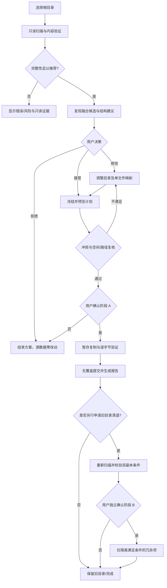

# 04 业务任务流程与状态机

## 1. 智能整理：一条完整可执行的用户旅程

**正式状态**：`NOT_SCANNED → SCANNING → ANALYZED | INCOMPLETE → PROPOSED → EDITED → PLANNED → EXECUTING → VERIFIED | PARTIAL | FAILED → REVIEWED`；旧目录清退为另一个 `RETIRE_PLANNED → RETIRE_EXECUTING → RETIRE_DONE | RETIRE_PARTIAL | BLOCKED`。这些是**目标领域/交互状态**；rc7 源码未必已全部持久化同名枚举。

### 执行门槛

- `SCAN/ANALYZE/PROPOSE/EDIT/PREVIEW`：不得写数据。若预览需要创建工作区，属于缺陷。
- `PLAN`：冻结根目录、目录树、源时间与内容摘要、目标前置条件。编辑后原计划失效。
- `EXECUTE`：显示操作量和冲突策略、权限、可取消性；再次确认后执行。
- `REVIEW`：必须向用户说明**有多少原文件有映射、实际生成多少目标、哪些失败/保留**。
- `RETIRE`：另开任务、另有确认，不以“建议已批准”为授权。

## 2. T-01 历史备份融合

**输入**：选择一对互不包含的来源目录与目标目录（推荐或手工）。  
**准备**：查共享内容、同相对路径一致、左右独有、同名不同内容及无法验证项。  
**输出**：缺失待复制列表、复用列表、冲突另存列表、需建立的空目录和预估复制字节。  
**执行**：复制源独有内容；目标已同内容可跳过；同路径异内容生成不覆盖的稳定命名；源目录不动。  
**验收**：逐字节一致、幂等重试、部分提交明确、方向可改、拒绝零写入。

## 3. T-02 重复文件整理

**输入**：已完成的字节内容等价组。  
**准备**：每组计算不同活动文件对象数，识别硬链接与隔离项；显示“可隔离 n，须保留 2”而非“可以删除 n”。  
**执行**：仅对核心计划通过再校验的条目隔离；撤销按受控日志处理。  
**验收**：文件组 1/2 份不能隔离；3 份最多隔离 1 份；出现外部变更立即阻断或重新规划。

## 4. T-03 照片整理

**输入**：范围、dHash 距离阈值、归档规则。  
**过程**：WIC 解码 → EXIF 日期可用性提示 → 相似候选供人工查看 → 按年月或类型生成目标路径及冲突预览。  
**执行**：只有用户确认具体归档计划才修改路径；相似候选决不直接加入删除计划。

## 5. T-04 批量重命名

**输入**：目录/通配/文件与文件夹选项、查找替换、编号、前后缀。  
**过程**：生成旧名→新名表、检查保留名、非法字符、大小写折叠冲突、路径嵌套、自覆盖。  
**执行**：受控移动/改名，写日志；允许合法情况下撤销。预览后任何新增、删除或修改源节点会使计划失效。

## 6. T-05 旧备份定向安全清退

**输入**：待清退来源目录 S。  
**过程**：仅对 S 内每个候选内容查找 **S 外**两份字节完全一致、不同文件对象、可访问且仍活动的文件。  
**结果**：明确列出 `eligible / blocked / unknown`；不能因目标结构已成功创建，就把 S 整体删除。  
**执行**：只隔离 eligible；blocked/unknown 坚持原位保留。还需复核剩余保留者不会被同一计划随后隔离。

## 7. T-06 目录差异比较

**输入**：左右两个已扫描子目录。  
**输出**：同路径相同、仅左、仅右、同路径异内容、相对结构/空目录差异、文件多重集重合、包含情况。  
**限制**：无法读取/验证的节点必须显示未知，不得输出“完全相等”。不强行猜测谁较新。

## 8. T-07 规则归档

**输入**：按类型或按年月、目标相对目录、递归选项、时间回退策略。  
**输出**：每文件的目标路径、同名冲突、规则无法归类项和复制/移动风险。  
**执行**：确认后受控变更；与重命名一样需要历史、撤销及计划复核。

## 9. 异常与恢复的统一对话

任何主题执行遇到 `source_changed / target_conflict / unreadable / workspace_invalid / journal_invalid / low_space / interrupted` 等异常时，统一使用：**问题是什么 → 哪些文件未处理 → 哪些已经核验提交 → 是否阻断下一次操作 → 应如何安全继续**。不得仅给“失败”或直接建议清空工作区。

## v2.1 L1 基础任务独立状态机

- **手动重复文件**：打开重复组→勾选待隔离文件→根据完整计划最终状态核验剩余两份独立副本→生成仅含选中项的隔离预览→用户单独确认→执行→重新扫描/审计；选择不合法则拒绝且无写入。
- **手动重复目录**：选择已判定相同的目录→逐文件计算在该目录之外的两个独立保留者→显示“可隔离项/被阻断项”→只隔离可处理项→结果复核；不能用 `fs::remove_all` 整树删除。
- **相似目录**：按内容关系检索候选（可能低重合）→选中目录对→生成事实报告→用户决定融合或仅查看；不得因自动建议阈值而隐藏手动候选。
- **指定目录融合**：用户任选 A/B（互不包含，位于根目录内）→完整评估→选择 A→B 或 B→A→详细复制与冲突预览→二次确认→阶段性复制、核验、无覆盖提交→重新扫描。任何“清退源目录”须单独发起。

状态 `UNKNOWN/INCOMPLETE` 必须阻止精确相同声明与高风险隔离；详细定义见 `12/13/14`。
