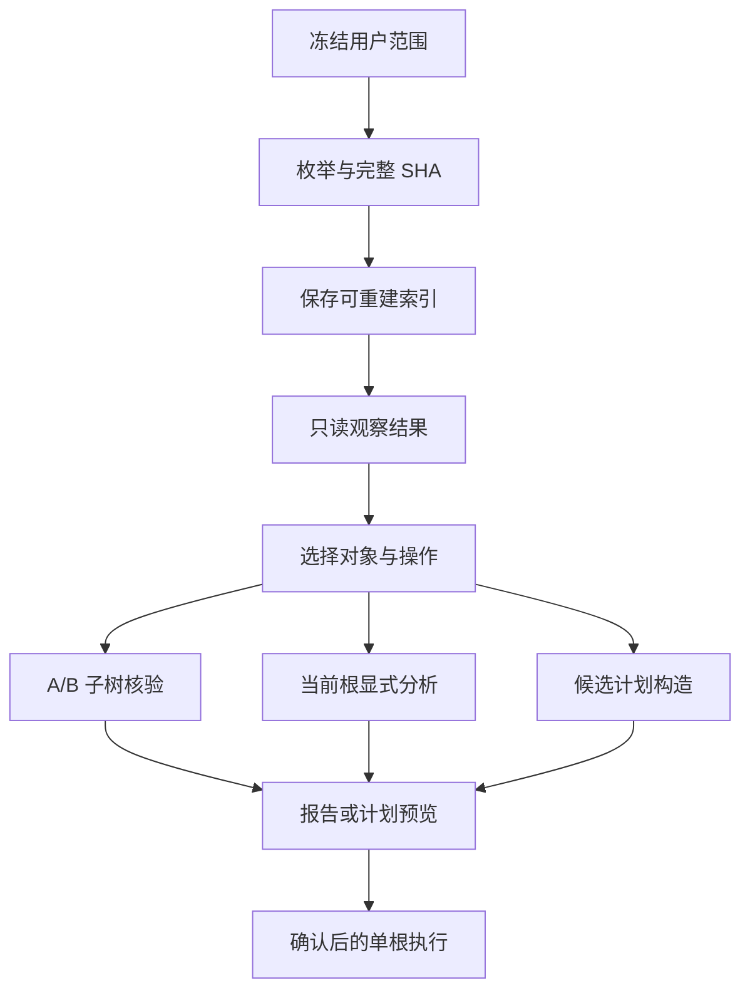
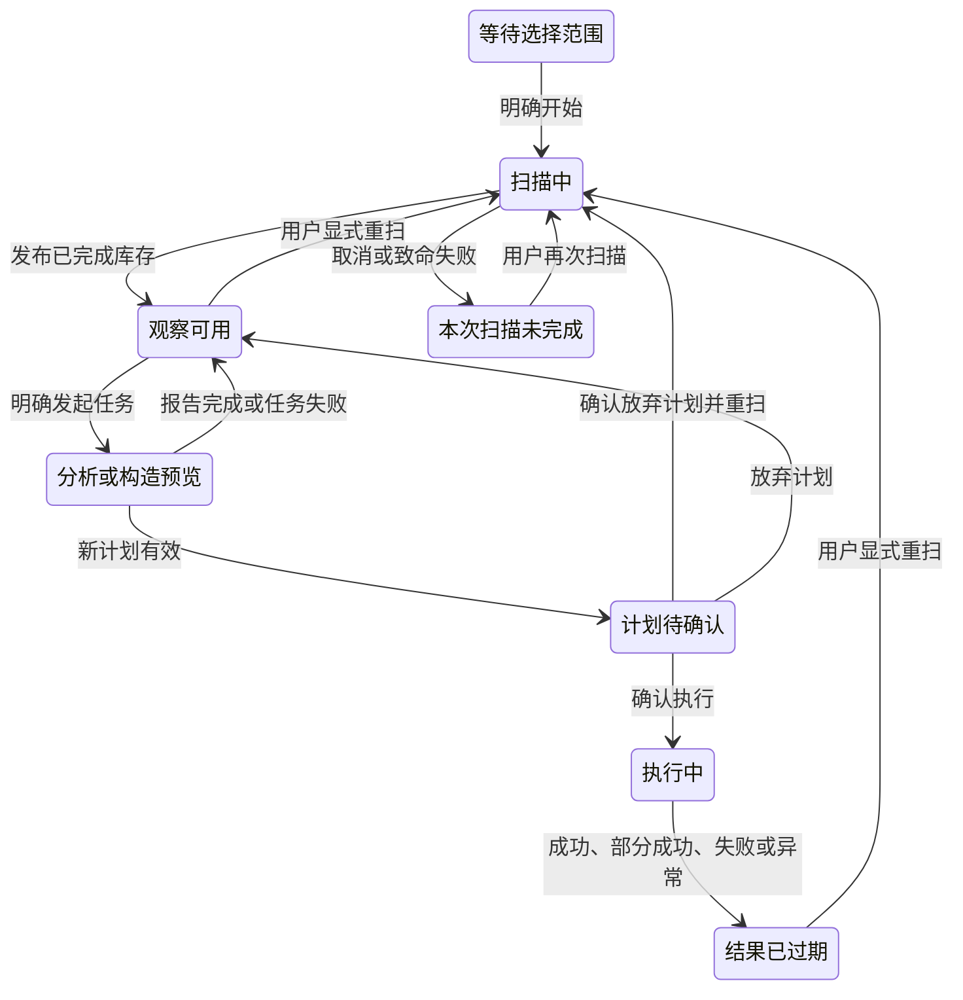

# 04 — 数据模型、模块边界与任务状态

> 1.0.2 交付补充：G-01/G-02/G-04 已补齐；缓存状态新增独立字段，CSV 带范围和状态。本文关于 1.0.1 的现状审计保留作对照，最新实现与验证以 [交付记录](../../RELEASE-ACCEPTANCE.md) 为准。

## 1. 模块边界

| 层次 | 职责 | 1.0.1 对应实现 |
|---|---|---|
| Win32 工作区与任务协调 | 范围冻结、观察视角、选择、命令分发、后台生命周期、进度显示、计划确认 | `src/win_main.cpp` 的 App、Task、JobResult |
| 枚举与完整内容索引 | 枚举、目录汇总、完整 SHA、逐根扫描、索引保存 | `scan`、`scan_hashed`、`scan_roots_hashed`；core.cpp、hash_index.cpp |
| 只读观察投影 | 文件副本候选、目录树候选、完整性 | `observe_scan`；observations.cpp |
| 精确比较与范围分析 | 字节等价、目录比较、A/B 过滤库存、相似目录发现 | core.cpp、scoped_analysis.cpp |
| 计划构造 | 按用户策略从候选生成隔离预览；命名、归档、融合、结构映射 | hash_actions.cpp、core.cpp |
| 执行与日志 | 校验快照、路径与策略；暂存、移动/复制、提交、恢复与可支持的撤销 | core.cpp |
| 照片能力 | 解码、日期与感知相似候选 | photo_windows.cpp；可移植环境使用替代实现 |
| 验证和诊断 | 回归、GUI smoke、Release 断言门槛、分阶段诊断 | tests、scripts、tools |

这些是职责划分，不代表已经拆成独立服务或存在数据库。当前 core.cpp 仍承载多类实现，模块进一步拆分不应改变公开语义。

## 2. 领域对象与身份

| 逻辑对象 | 所需内容 | 当前结构及实现边界 |
|---|---|---|
| 扫描输入 | 手动根路径，或选定卷的身份与路径 | DriveChoice 记录 root、kind、serial、可取得的 GUID；容量和剩余空间用于说明，不是哈希分母 |
| 根库存 | 根路径、文件、目录、总字节、错误 | Inventory；complete() 当前由 errors 是否为空判定 |
| 文件记录 | 根内相对路径、字节数、mtime、SHA、验证内容身份 | File；content 初始为 -1；完整哈希不会自动赋予精确内容身份 |
| 目录记录 | 根内路径、累计文件数、累计逻辑字节 | Folder；空目录作为目录记录保留 |
| 多根扫描 | 各根库存、整体错误、总量、跨根候选成员 | FullScan；各根仍是独立操作边界 |
| 候选分组 | 大小、完整 SHA、每个成员的根和文件索引 | ScopeHashGroup / ScopeOccurrence |
| 观察投影 | 文件/目录位置索引与候选份数 | FileObservation / FolderObservation；不拥有另一套原文件内容 |
| 精确分析 | 内容分组、目录关系或双目录报告及分析范围 | Duplicates、DirectoryPairReport 等 |
| 选择上下文 | 当前会话/根、对象种类、规范化相对路径；必要时对应建议记录 | UI 目前以行身份和路径保存选择；没有持久化的独立 SelectionContext 表 |
| 操作计划 | 类型、单根范围、冻结路径、源/目标快照、适用策略和警告 | Plan、MergePlan、StructurePlan；三者不能假定具有相同字段 |
| 进度快照 | 阶段、当前根和路径、字节/文件计数、错误、耗时 | ScanProgress；见性能设计的计数定义 |
| 历史记录 | 操作对象、事务阶段、成功/部分成功/失败、恢复或撤销结果 | 执行器工作区及日志；与可清理缓存分离 |

设计上必须用“扫描会话＋根身份＋对象路径/类型”理解一个选择，不能只用列表行号。1.0.1 尚未把所有概念建为统一持久化实体；重新扫描会清除旧库存与派生状态，不支持把上次会话的内存索引直接当成新对象身份。

卷身份检查用于发现设备断开或盘符被另一卷占用；它不是物理独立副本证明。手动目录模式还有输入路径与当前根的一致性检查；不得泛化宣称所有输入方式都已具备相同的硬件身份层。

## 3. 内容证据状态

| 状态 | 可以显示什么 | 不能推导什么 |
|---|---|---|
| 仅枚举到元数据 | 已发现路径、大小、时间与发现量 | 完整哈希、重复结论、最终目录完整性 |
| 完整 SHA 可用 | 同大小同哈希候选、候选出现次数 | 已逐字节验证、独立对象数量、跨盘备份可靠性 |
| 任务内字节核验完成 | 对应任务范围的精确文件/目录结论 | 根外或未核验范围也已验证；结果永远不再变化 |
| 部分失败/不完整 | 可用的局部事实及错误 | 所有目录已排除重复、零候选就是确定没有副本 |
| 已知过期 | 上次快照、操作历史和参考导出 | 继续用旧快照生成或执行新整理任务 |

候选计划在私有临时库存中建立用于既有计划器的候选身份，不得修改观察库存，使其误显示为已经核验。A/B 分析同样使用临时范围库存；一次 A/B 验证不会把整个根标成 exact_ready。

副本策略快照与证据状态不同：用户选择快速模式可以授权采用较低的执行复核等级，但不能据此修改历史事实，声称执行前重新比较过字节。

## 4. 从扫描到分析的运行关系

保存缓存失败应报告，但不等于内存中的所有哈希结果失效。观察汇总读取内存库存，不重新读取原文件。只有用户明确请求的后续任务才增加内容核验、照片解码或建议计算。

进入已扫描单盘操作范围复用现有库存，不自动再哈希；切回多盘总览也不扫描。当前观察中的候选计数范围与单根精确计数范围尚有标签一致性差距，见实施状态。

## 5. 工作区状态机

下图是产品状态定义，不假称 1.0.1 存在同名 C++ 状态枚举：

“观察可用”可能带读取错误，应明确标为结果不完整；它与取消后未发布的扫描不同。当前需要完整库存的操作仍会拒绝不完整根。常规根枚举或读取失败可保留其他成功根及错误入口，不能以其余成功掩盖失败。当前 GUI 将选定卷身份变化或断开作为致命任务错误处理，不发布该次多根结果；若要求此时仍发布已完成根，须另行定义发布条件和身份有效性，不能描述为已经支持。

### 状态与允许行为

| 状态 | 允许 | 阻止或要求 |
|---|---|---|
| 扫描/分析中 | 查看阶段和进度；可取消任务请求停止 | 冻结输入与选择，禁止另起互相冲突的任务 |
| 正常结果 | 切换视角、搜索、选择、查看、按范围发起任务 | 新任务冻结对应路径与条件 |
| 有效预览 | 查看路径、范围、冻结策略；确认或放弃 | 修改映射要重建；新预览失败不得保留旧执行入口 |
| 写入执行中 | 查看执行状态 | 当前写任务不提供中途取消；关闭窗口需等待任务结束 |
| 过期结果 | 查看历史和旧快照、打开位置、参考导出、显式重扫 | 新分析和文件操作受阻；切换多盘/单盘不能解除过期标志 |
| 新扫描取消 | 查看失败/停止信息、重新选择范围 | 不能恢复旧计划或把被清除的旧库存重新启用 |

UI 当前用 busy、has_scan、has_full_scan、exact_ready、has_pending、results_stale 等字段实现状态。任务完成回调和错误回调均须执行一致的失效规则，尤其写任务的外层异常不能留下可操作旧库存。

## 6. 并发和生命周期

当前 App 在一次任务中使用一个后台 worker。进度写入带互斥保护的最新快照，UI 定时读取；完成结果经窗口消息交回主线程。不得将每个读取块的进度无限堆入窗口消息队列。

读取任务的取消是协作式的：在块边界及循环中检查标志。操作系统同步 I/O 尚未返回时，应用不能声称已取消。写任务目前没有相同的取消接口；关闭窗口时不能直接销毁仍被 worker 使用的 App 或窗口状态。

选择、根路径、策略和任务参数在启动前冻结。忙碌期间的 UI 禁用是防止错选的一层措施，执行器仍须独立验证路径和快照；不能以“按钮被禁用”替代内容或事务检查。

## 7. 持久化的不同责任

缓存保存的是可重建的内容索引，位置在用户应用缓存目录；用户数据根下的事务日志、暂存与隔离区用于追溯实际操作。二者不能互相替代。

当前缓存格式与记录并没有提供完整的跨次可信复用协议。未来引入扫描会话持久化、续扫、文件身份和变化证据时，必须定义格式版本、被替换卷、外部修改、失败与取消后的状态，并保留完整重读的明确路径。
